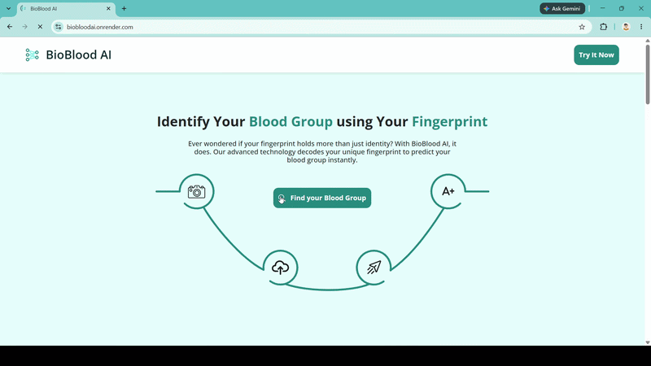

<div align="center">


# BioBlood AI

### Exploring blood-group prediction through fingerprint image analysis

An interactive, full-stack AI prototype that accepts a fingerprint image and <br> returns a predicted blood-group class with the model's confidence score.

[](https://www.python.org/)
[](https://flask.palletsprojects.com/)
[](https://www.tensorflow.org/)

**[Live Demo](https://biobloodai.onrender.com/)**

</div>

## 💡 About The Project

**BioBlood AI** is an interactive, full-stack prototype exploring whether image-based machine learning can classify blood-group patterns from fingerprints. It bridges computer vision and web development into a seamless user experience: upload a fingerprint image, execute model inference instantly, and review the predicted blood-group class alongside its confidence score.

### Built With

* **Frontend:** HTML, CSS, JavaScript, Bootstrap
* **Backend & API:** Python, Flask
* **Machine Learning:** TensorFlow, Keras, NumPy, Pillow
* **Model Artifact:** Custom convolutional neural network [`model/blood_group_prediction.h5`](./model/blood_group_prediction.h5)

---

## 📺 Demo

**🔗 Experience the app live here:** [https://biobloodai.onrender.com](https://biobloodai.onrender.com)



---

## 🚀 Getting Started

Follow these instructions to set up and run the project locally on your machine.

### Prerequisites

* Python `3.11`
* `pip`

### Installation

1. **Clone the repository**
   ```powershell
   git clone https://github.com/reddy-chandu/BioBlood_AI
   cd BioBlood_AI
   ```

2. **Create and activate a virtual environment**
   ```powershell
   python -m venv .venv
   .\.venv\Scripts\Activate.ps1
   ```
   *(For macOS/Linux, use: `source .venv/bin/activate`)*
   
3. **Install dependencies**
   ```powershell
   pip install -r requirements.txt
   ```

4. **Run the application**
   ```powershell
   python app.py
   ```

5. **Access the web app**
   
   Open your browser and navigate to 

   ```
   http://localhost:5000
   ```

---

## 📁 Project Architecture

```text
BioBlood_AI/
├── app.py                  # Flask routing and inference pipeline
├── requirements.txt        # Python package dependencies
├── model/
│   └── blood_group_prediction.h5   # Pre-trained TensorFlow/Keras model
├── templates/
│   ├── index.html          # Landing page template
│   └── home.html           # Interactive upload & results view
└── static/
    ├── css/style.css       # Custom styling rules
    ├── js/script.js        # Client-side image preview & async requests
    └── img/                # Logos, UI illustrations, and assets
```

---

## ⚠️ Important Disclaimers

> **Medical Disclaimer:** BioBlood AI is strictly an **educational and research prototype**. It is not a medical device and must never be used for clinical diagnosis, medical treatment, or real-world blood typing. Always rely on certified professional laboratory testing.
> 
> **Privacy Note:** Uploaded fingerprints are processed directly in-memory and are not intentionally stored to disk. However, do not upload real personal biometric data to public or unverified server deployments.

---

## 📝 License

Distributed under the **MIT License**. See the [LICENSE](./LICENSE) file for more details.